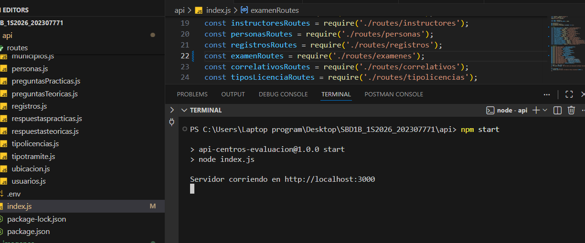
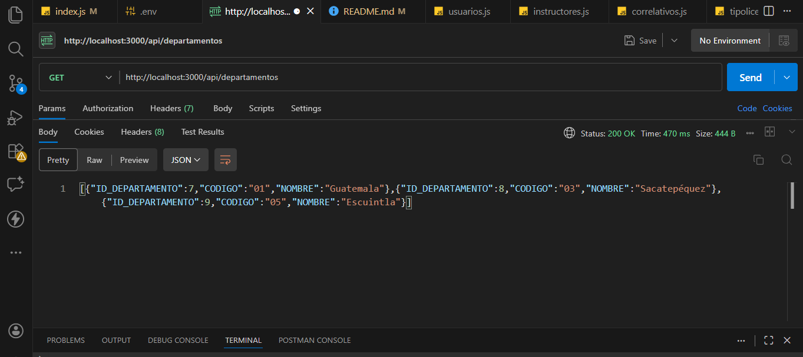
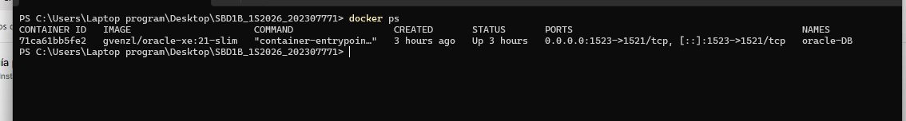
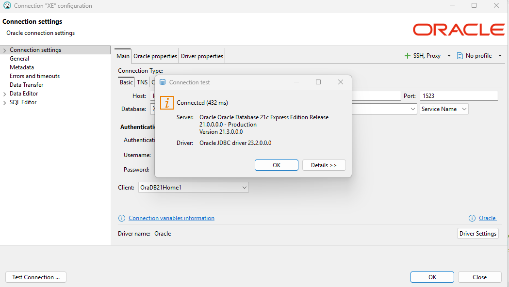
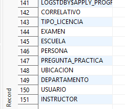

# SBD1B_1S2026_202307771

Centro de Evaluación de Manejo – Proyecto 2 (1S2026)
# Estudiante: Mayelin Lucía Quevedo Camey
# Carnet: 202307771
# Curso: Sistemas de Bases de Datos 1
# Fecha: 30/04/2026

# Tabla de Contenidos
1. Descripción del Proyecto
2. Tecnologías Utilizadas
3. Requisitos Previos
4. Estructura del Proyecto
5. Configuración e Instalación
    Levantar la Base de Datos con Docker
    Cargar Datos Iniciales
    Ejecutar el API REST
6. Endpoints del API
    CRUD por Tabla
    Consultas Estadísticas
7. Pruebas con Postman
8. Verificación con DBeaver
9. Evidencias
10. Autor

# Descripción del Proyecto
Este proyecto implementa una arquitectura moderna para la gestión de Centros de Evaluación de Manejo. La solución dockeriza una base de datos Oracle XE, la inicializa automáticamente con un script DDL y expone todos los datos mediante un API REST desarrollado en Node.js + Express. El sistema permite operaciones CRUD completas sobre las entidades del modelo y genera tres consultas estadísticas obligatorias:

    Promedios de puntajes por centro/escuela.
    Ranking de evaluados.
    Análisis de dificultad de preguntas.

De esta forma se elimina la manipulación directa de tablas y se garantiza portabilidad y seguridad en el acceso.

# Tecnologías Utilizadas

1. Docker	27+	Contenerización y orquestación
2. Oracle Database XE	21c	Motor de base de datos relacional
3. Node.js	22.x	Entorno de ejecución del backend
4. Express	4.x	Framework para el API REST
5. oracledb	6.3+	Driver oficial de Oracle para Node.js
6. DBeaver	24.x	Cliente gráfico para administración y validación
7. Postman	11.x	Prueba y documentación de endpoints

# Requisitos Previos
Antes de comenzar, asegúrate de tener instalado en tu equipo:

1. Docker Desktop (con WSL2 en Windows).
2. Node.js (versión 18 o superior).
3. DBeaver (versión Community).
4. Postman (recomendado).
5. Git (para clonar el repositorio).

# Cargar Datos Iniciales

El script `scripts/init.sql` se ejecuta automáticamente al primer inicio del contenedor, creando las tablas y algunos datos de catálogo. Para cargar los datos completos del JSON, se proporciona un script SQL adicional (`insert.sql`) que puede ejecutarse en DBeaver.

# Levantar la Base de Datos con Docker
Abre una terminal en la raíz del proyecto y ejecuta:

1. Levantar la base de datos Oracle con Docker (docker-compose up -d).
2. Verificar que el contenedor esté corriendo (docker ps).
3. Instalar las dependencias del API (npm install dentro de api/).
4. Configurar las variables de entorno (archivo .env).
5. Iniciar el servidor Node.js (npm start).
6. Comprobar que el API responde (por ejemplo, visitar http://localhost:3000/api/departamentos).

# docker-compose up -d
Este comando descargará la imagen gvenzl/oracle-xe:21-slim, 
creará un contenedor llamado oracle-DB, 
mapeará el puerto 1523 de tu máquina al puerto interno 1521, 
montará el volumen oracle_data para persistencia y ejecutará automáticamente el script scripts/init.sql la primera vez que se inicie.

El volumen `oracle_data` garantiza que los datos no se pierdan al reiniciar el contenedor. La primera inicialización puede tardar varios minutos.

# Para verificar que el contenedor está corriendo: docker ps

# se deberia poder ver algo como:
CONTAINER ID   IMAGE                      PORTS                                         NAMES
71ca61bb5fe2   gvenzl/oracle-xe:21-slim   0.0.0.0:1523->1521/tcp                        oracle-DB

# para confirmar que la base esta lista:
docker-compose logs oracle-db
Buscamos el mensaje: DATABASE IS READY TO USE!

Ejecutar el API REST
3.1 Instalar dependencias
Dentro de la carpeta api:
bash
cd api
npm install

3.2 Configurar variables de entorno
Editar  el archivo .env con los siguientes valores:

env
PORT=3000
DB_USER=system
DB_PASSWORD=oracle123
DB_CONNECTION_STRING=localhost:1523/XE

# Iniciar el servidor
bash
* npm start

El servidor iniciará en http://localhost:3000. 

se verá el mensaje:
# Servidor corriendo en http://localhost:3000

CRUD por Tabla
Cada tabla expone las operaciones estándar:
# uso de endpoints
Método	Endpoint	Descripción
- GET	/api/departamentos	Listar todos los departamentos
- GET	/api/departamentos/{id}	Obtener un departamento por ID
- POST	/api/departamentos	Crear nuevo departamento
- PUT	/api/departamentos/{id}	Actualizar departamento
- DELETE	/api/departamentos/{id}	Eliminar departamento

**Crear un departamento (POST)**
POST /api/departamentos
Content-Type: application/json

{
    "codigo": "99",
    "nombre": "Departamento Prueba"
}

**Actualizar un departamento (PUT)**
PUT http://localhost:3000/api/departamentos/4
Content-Type: application/json

{
    "codigo": "99",
    "nombre": "Departamento Actualizado"
}

**ELIMINAR UN DEPARTAMENTO (DELETE)**
departamento con id 4 
DELETE http://localhost:3000/api/departamentos/4

El mismo patrón se repite para:

- /api/municipios
- /api/centros
- /api/escuelas
- /api/ubicaciones
- /api/usuarios
- /api/instructores
- /api/personas
- /api/registros
- /api/examenes
- /api/correlativos
- /api/tipos-licencia
- /api/tipos-tramite
- /api/preguntas-teoricas
- /api/preguntas-practicas
- /api/respuestas-teoricas
- /api/respuestas-practicas

Consultas Estadísticas

1. GET	/api/estadisticas/promedios	            Promedio de puntajes teóricos y prácticos agrupados por centro.
2. GET	/api/estadisticas/ranking	            Lista de personas ordenadas por puntaje total (teórico + práctico).
3. GET	/api/estadisticas/dificultad-preguntas	Porcentaje de aciertos por pregunta teórica (dificultad descendente).

Todos los GET, POST, PUT, DELETE de cada tabla.

 Verificación con DBeaver
Para comprobar que las tablas y datos se crearon correctamente:

- Abre DBeaver.

Crea una nueva conexión a Oracle con los siguientes parámetros:

- Host: localhost
- Puerto: 1523 (o el que hayas configurado en docker-compose.yml)
- Service Name: XE
- Usuario: system
- Contraseña: oracle123
Haz clic en Test Connection – debe ser exitosa.

# Nombre: Mayelin Quevedo
# Carnet: 202307771
# Curso: Sistemas de Bases de Datos 1

Auxiliares: Estephanie Alejandra Ruiz (github: Tefy1317)

# conexion DBEAVER
creamos nueva conexión:

Host: localhost
Puerto: 1523 
Service name: XE
Usuario: system
Contraseña: oracle123

- Pasos a seguir para crear la conexión en DBeaver:

1. Abrir DBeaver → Nueva conexión → Oracle.
2. Llenar los campos con los datos anteriores.
3. Hacer clic en "Test Connection" para verificar.

