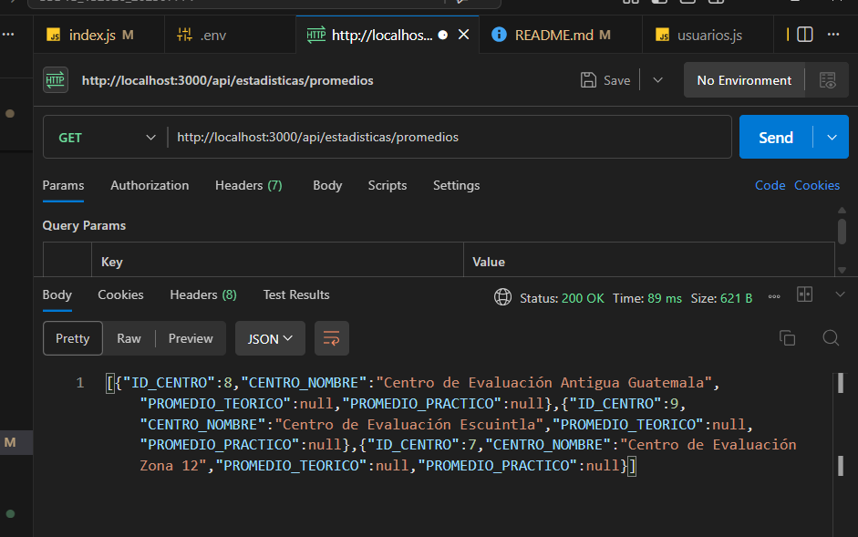
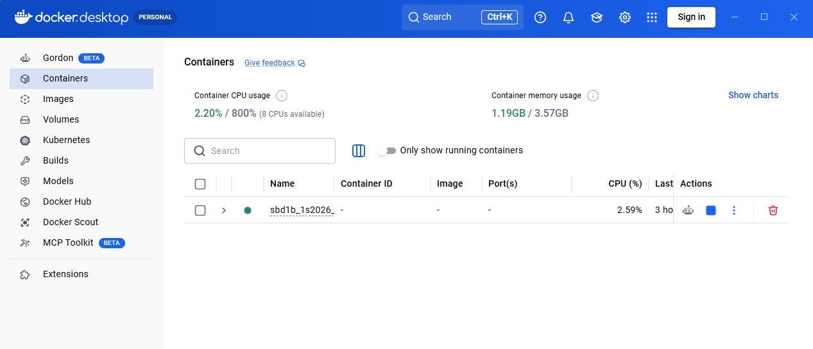

# SBD1B_1S2026_202307771

Centro de Evaluación de Manejo – Proyecto 2 (1S2026)
# Estudiante: Mayelin Lucía Quevedo Camey
# Carnet: 202307771
# Curso: Sistemas de Bases de Datos 1
# Fecha: 30/04/2026

     Tabla de Contenidos
1.Descripción del Proyecto
2.Tecnologías Utilizadas
3.Requisitos Previos
4.Estructura del Proyecto
5.Configuración e Instalación
    Levantar la Base de Datos con Docker
    Cargar Datos Iniciales
    Ejecutar el API REST
6.Endpoints del API
    CRUD por Tabla
    Consultas Estadísticas
7.Pruebas con Postman
8.Verificación con DBeaver
9.Evidencias
10.Autor

Descripción del Proyecto
Este proyecto implementa una arquitectura moderna para la gestión de Centros de Evaluación de Manejo. La solución dockeriza una base de datos Oracle XE, la inicializa automáticamente con un script DDL y expone todos los datos mediante un API REST desarrollado en Node.js + Express. El sistema permite operaciones CRUD completas sobre las entidades del modelo y genera tres consultas estadísticas obligatorias:

    Promedios de puntajes por centro/escuela.
    Ranking de evaluados.
    Análisis de dificultad de preguntas.

De esta forma se elimina la manipulación directa de tablas y se garantiza portabilidad y seguridad en el acceso.

Tecnologías Utilizadas

Docker	27+	Contenerización y orquestación
Oracle Database XE	21c	Motor de base de datos relacional
Node.js	22.x	Entorno de ejecución del backend
Express	4.x	Framework para el API REST
oracledb	6.3+	Driver oficial de Oracle para Node.js
DBeaver	24.x	Cliente gráfico para administración y validación
Postman	11.x	Prueba y documentación de endpoints

Requisitos Previos
Antes de comenzar, asegúrate de tener instalado en tu equipo:

Docker Desktop (con WSL2 en Windows).
Node.js (versión 18 o superior).
DBeaver (versión Community).
Postman (opcional pero recomendado).
Git (opcional, para clonar el repositorio).

 Levantar la Base de Datos con Docker
Abre una terminal en la raíz del proyecto y ejecuta:

bash
docker-compose up -d

Este comando descargará la imagen gvenzl/oracle-xe:21-slim, creará un contenedor llamado oracle-DB, mapeará el puerto 1523 de tu máquina al puerto interno 1521, montará el volumen oracle_data para persistencia y ejecutará automáticamente el script scripts/init.sql la primera vez que se inicie.

Para verificar que el contenedor está corriendo: docker ps

se deberia poder ver algo como:
CONTAINER ID   IMAGE                      PORTS                                         NAMES
71ca61bb5fe2   gvenzl/oracle-xe:21-slim   0.0.0.0:1523->1521/tcp                        oracle-DB

para revisar logs y confirmar que la base esta lista:
docker-compose logs oracle-db

Busca el mensaje: DATABASE IS READY TO USE!

Ejecutar el API REST
3.1 Instalar dependencias
Dentro de la carpeta api:

bash
cd api
npm install
3.2 Configurar variables de entorno
Edita el archivo .env (ya incluido) con los siguientes valores (ajusta si cambiaste puerto o contraseña):

env
PORT=3000
DB_USER=system
DB_PASSWORD=oracle123
DB_CONNECTION_STRING=localhost:1523/XE
3.3 Iniciar el servidor
bash
npm start

npm run dev
El servidor iniciará en http://localhost:3000. Verás el mensaje:

text
Servidor corriendo en http://localhost:3000

CRUD por Tabla
Cada tabla expone las operaciones estándar:

Método	Endpoint	Descripción
GET	/api/departamentos	Listar todos los departamentos
GET	/api/departamentos/{id}	Obtener un departamento por ID
POST	/api/departamentos	Crear nuevo departamento
PUT	/api/departamentos/{id}	Actualizar departamento
DELETE	/api/departamentos/{id}	Eliminar departamento
El mismo patrón se repite para:

/api/municipios
/api/centros
/api/escuelas
/api/ubicaciones
/api/usuarios
/api/instructores
/api/personas
/api/registros
/api/examenes
/api/correlativos
/api/tipos-licencia
/api/tipos-tramite
/api/preguntas-teoricas
/api/preguntas-practicas
/api/respuestas-teoricas
/api/respuestas-practicas

Consultas Estadísticas (obligatorias)
Método	Endpoint	Descripción
GET	/api/estadisticas/promedios	Promedio de puntajes teóricos y prácticos agrupados por centro.
GET	/api/estadisticas/ranking	Lista de personas ordenadas por puntaje total (teórico + práctico).
GET	/api/estadisticas/dificultad-preguntas	Porcentaje de aciertos por pregunta teórica (dificultad descendente).

Pruebas con Postman
Se incluye en el repositorio el archivo postman_collection.json. Para utilizarlo:

Abre Postman.
Todos los GET, POST, PUT, DELETE de cada tabla.

 Verificación con DBeaver
Para comprobar que las tablas y datos se crearon correctamente:

Abre DBeaver.

Crea una nueva conexión a Oracle con los siguientes parámetros:

Host: localhost
Puerto: 1523 (o el que hayas configurado en docker-compose.yml)
Service Name: XE
Usuario: system
Contraseña: oracle123
Haz clic en Test Connection – debe ser exitosa.

Nombre: Mayelin Quevedo
Carnet: 202307771
Curso: Sistemas de Bases de Datos 1

Auxiliares: Estephanie Alejandra Ruiz (github: Tefy1317)

